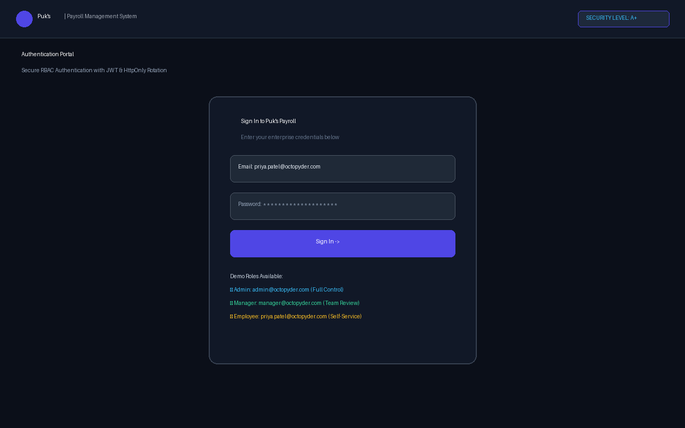
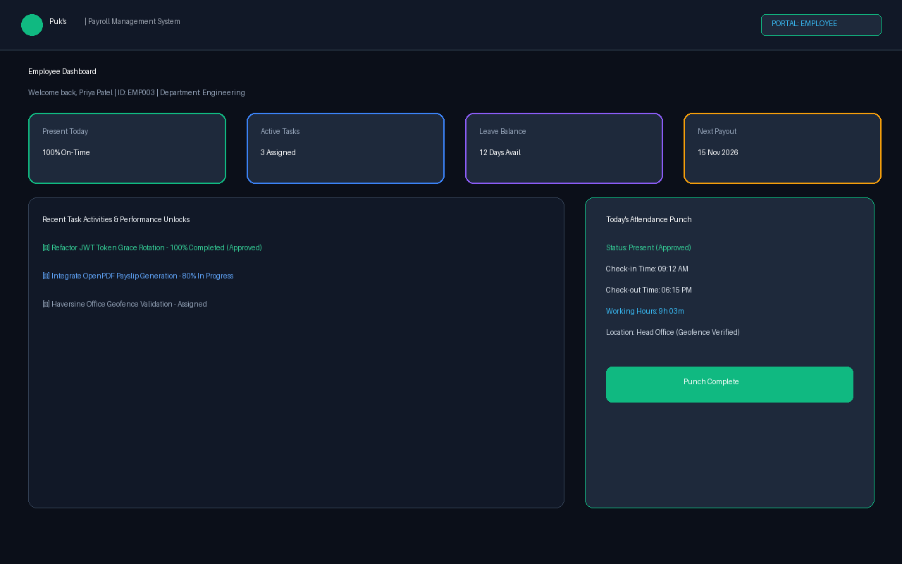
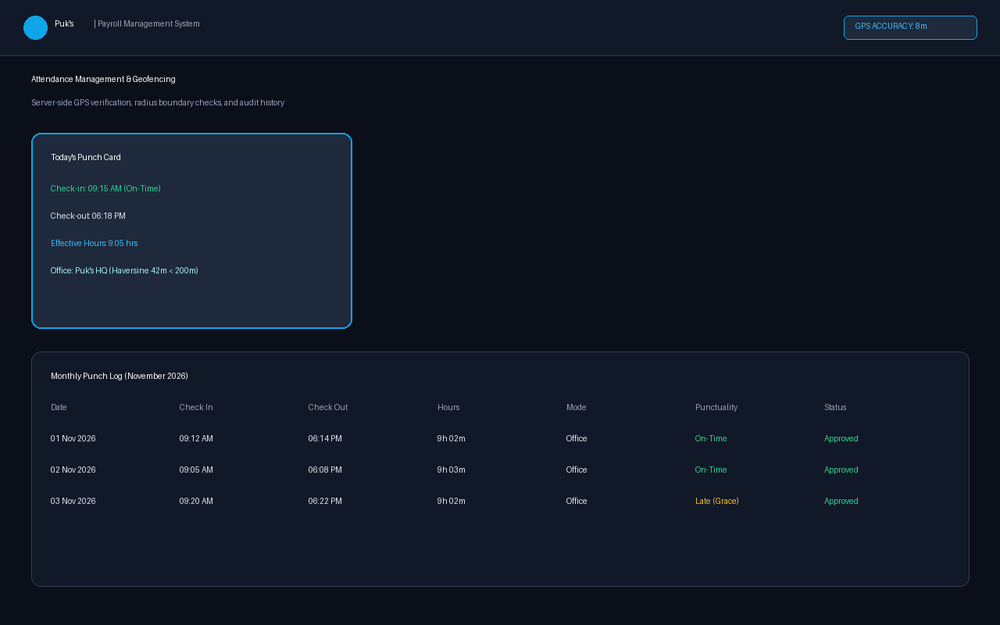
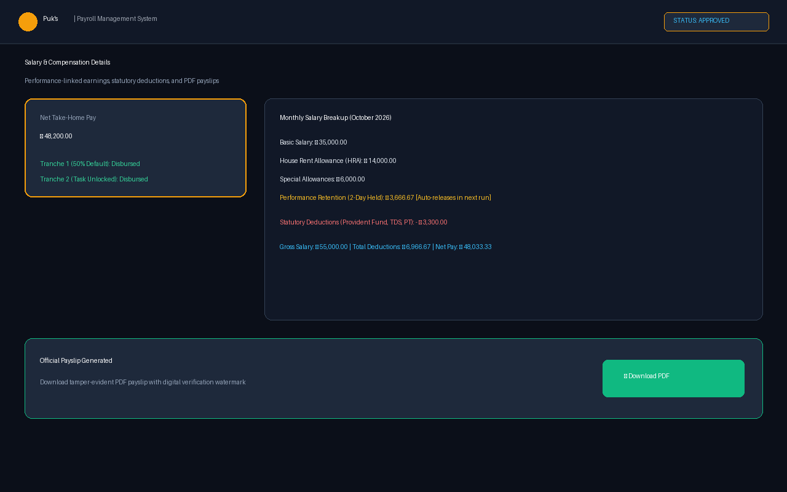
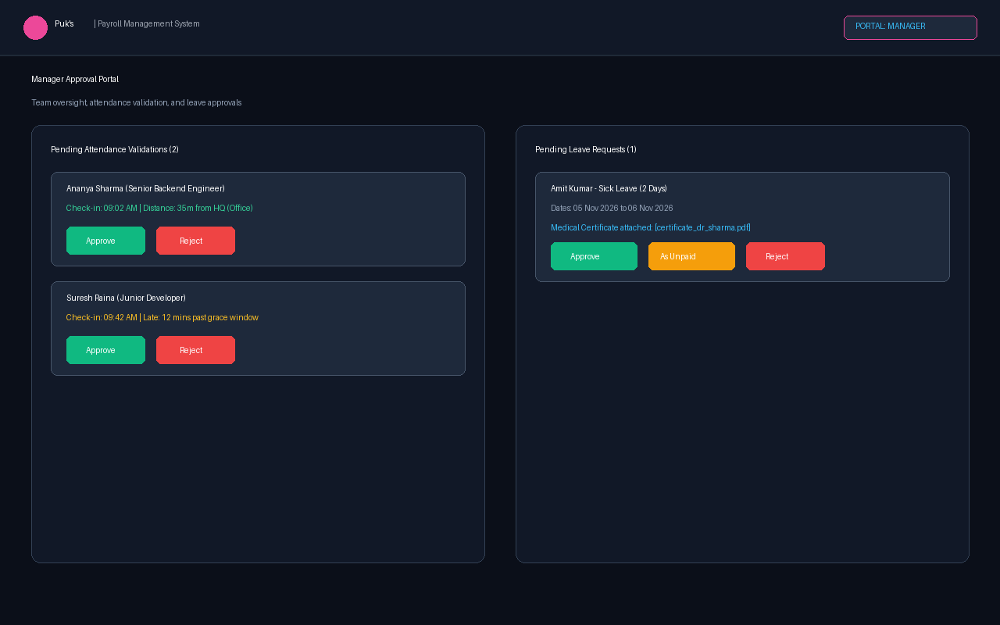
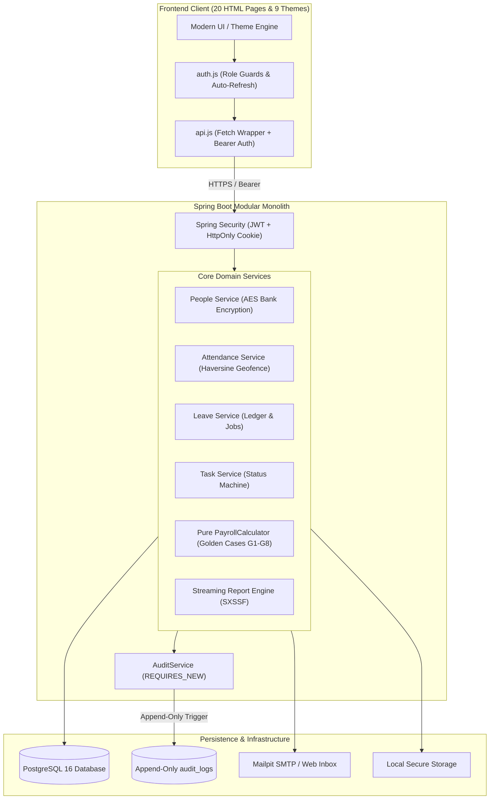

# Puk's — Enterprise Cloud Payroll & Workforce Management System

[](https://openjdk.org/)
[](https://spring.io/projects/spring-boot)
[](https://www.postgresql.org/)
[](https://flywaydb.org/)
[-success)](#security-architecture)
[](LICENSE)

A production-grade, modular monolith cloud payroll and workforce management platform built with **Java 25**, **Spring Boot 4**, and **PostgreSQL 16**. Designed for enterprise scalability, financial precision, and rigorous zero-trust security.

---

## 1. Highlights & Core Capabilities

- **Pure-Domain Payroll Calculation Engine:**
  - Zero Spring or JPA dependencies verified by ArchUnit tests.
  - Tested against golden test suites (G1–G8) ensuring component-level `HALF_UP` rounding precision without compounding rounding drift.
  - Support for mid-month joiner proration, statutory deductions (PF, TDS, PT), and negative net clamps.
- **Two-Tranche Disbursements & 3-Tier Performance Retentions:**
  - Automatic 50% default tranche disbursement upon generation.
  - Remainder disbursement linked to manager-approved task completion.
  - 3-tier performance retention system: 0-day, 2-day (auto-released in the subsequent month's run), and 7-day (held until manual release/forfeiture with audit note).
- **Geofenced Attendance with GPS Verification:**
  - Server-side Haversine coordinate validation against active office radii or corporate IP CIDRs.
  - Independent punctuality and day-type derivation (15/30 min grace thresholds; half-day vs full-day).
  - Midnight-crossing shift support and automated daily close cron jobs with missed checkout catch-up.
- **Double-Entry Leave Management Ledger:**
  - Immutable balance ledgers with append-only database triggers.
  - Idempotent monthly credit jobs and annual April 1st balance reset with carry-forward limits.
  - Medical certificate attachments with magic-byte content validation.
- **Task Management & Performance Unlocks:**
  - Multi-state task machine (`ASSIGNED` → `IN_PROGRESS` → `PENDING_APPROVAL` → `APPROVED` / `REJECTED` / `CANCELLED`).
  - Progress increments in steps of 10 with automatic review submission at 100%.
- **Streaming Reports & PDF Payslips:**
  - Memory-efficient Apache POI SXSSF streaming for Excel/CSV exports with CSV formula injection protection (`=`, `+`, `-`, `@`).
  - OpenPDF-powered payslip generation and employee ID card downloads with authenticated streaming.
- **Rich Responsive UI with 9 Themes:**
  - Clean client interface with 9 selectable design themes (Light, Dark, Glassmorphism, Bold Typography, Cyberpunk, Neo-Brutalism, Minimalist, Pastel, Sunset).

---

## 📸 Visual Showcase & Live Previews

| Authentication Portal | Employee Dashboard |
| :---: | :---: |
|  |  |

| GPS Geofenced Attendance | Salary & Payslip Breakdown | Manager Review Portal |
| :---: | :---: | :---: |
|  |  |  |

---

## 🎬 Interactive Walkthrough Video

Experience the full end-to-end user journey across all roles through the interactive walkthrough player:
- **Interactive Video Player:** [`assets/walkthrough_video.html`](assets/walkthrough_video.html)
- **How to View:** Open `assets/walkthrough_video.html` in your web browser to view step-by-step scene walkthroughs covering:
  1. **Dual-Token Authentication & Role-Based Entry:** Short-lived JWTs, rotating HttpOnly refresh cookies, and rate-limiting safeguards.
  2. **Employee Hub & Real-Time KPI Telemetry:** Dynamic widgets for attendance %, leave balances, pending tasks, and net salary.
  3. **Geofenced GPS Punch & Haversine Verification:** Live coordinate proximity checks and attendance timeline visualization.
  4. **Double-Entry Leave Ledger & Automated Accruals:** Append-only balance ledger, medical certificate uploads, and manager approvals.
  5. **Pure Domain Payroll Engine & Multi-Tier Retentions:** Zero-drift calculations, 2-day/7-day retentions, and PDF payslips.
  6. **Immutable Audit Trail & Streaming SXSSF Reports:** Append-only logging and memory-safe Excel/CSV data exports.

---

## 2. Architecture & Design

### 2.1 Modular Monolith Package Structure
The system enforces strict package boundaries (`controller → service → repository`) within `com.octopyder.payroll`:

```text
com.octopyder.payroll
├── auth            # JWT issuance, refresh cookie rotation, rate limiting, lockout
├── people          # Employee/manager profiles, AES-256 encrypted bank accounts, ID cards
├── org             # Office locations, geofencing, holidays, system settings registry
├── task            # Task lifecycle, activities, progress, attachments
├── attendance      # Geofenced check-in/out, punch logs, manager validations, close job
├── leave           # Double-entry ledger, monthly credit jobs, approvals
├── payroll         # Pure PayrollCalculator, workflow runs, retentions, payslip PDFs
├── dashboard       # Role-specific KPI aggregations (Admin, Manager, Employee)
├── notification    # In-app polling notifications and email delivery
├── audit           # Append-only audit logs with DB immutability triggers
├── report          # Memory-safe streaming SXSSF Excel, CSV, and PDF report engine
└── common          # BusinessClock, ProblemDetail exception handler, PageResponse
```

### 2.2 System Architecture Diagram



---

## 3. Security Architecture

- **Encrypted at Rest:** Employee bank account numbers are protected with **AES-256-GCM** authenticated encryption and masked in all UI responses (`XXXX-XXXX-1234`).
- **Stateless Tokens with Rotated Refresh Cookies:** Short-lived JWT access tokens paired with cryptographically random refresh tokens stored as hashed secrets, with a 20-second grace window rotation preventing parallel tab conflicts.
- **Append-Only Audit Trails:** Database-level trigger on `audit_logs` rejects any `UPDATE` or `DELETE` statements, ensuring forensic immutability.
- **Account Lockout & Rate Limiting:** 5 consecutive invalid credentials lock the account; Bucket4j rate limits protect authentication and report endpoints.
- **Content Security Policy (CSP) & Subresource Integrity (SRI):** External CDN dependencies specify strict SHA-384 SRI hashes; framing is disabled (`frame-ancestors 'none'`).
- **Formula Injection Sanitization:** CSV exports automatically escape formulas starting with `=`, `+`, `-`, or `@`.

---

## 4. Quickstart Guide

### 4.1 Prerequisites
- **Java 25 JDK** installed and added to `PATH`
- **Docker Desktop** installed and running
- **Maven** (or use the included `./mvnw` wrapper)

### 4.2 Starting the System

1. **Start PostgreSQL Database and Mailpit:**
   ```bash
   docker compose up -d db mailpit
   ```

2. **Launch Application with Demo Seed Data:**
   ```bash
   # On Windows PowerShell:
   .\mvnw spring-boot:run "-Dspring-boot.run.profiles=local" "-Dspring-boot.run.arguments=--app.seed-demo-data=true"

   # On macOS / Linux:
   ./mvnw spring-boot:run "-Dspring-boot.run.profiles=local" "-Dspring-boot.run.arguments=--app.seed-demo-data=true"
   ```

3. **Access Portals:**
   - **Web Application:** [http://localhost:8080/index.html](http://localhost:8080/index.html)
   - **Mailpit Web Inbox (Email testing):** [http://localhost:8025](http://localhost:8025)

---

## 5. Pre-Seeded Demo Logins

| Role | Email | Password | Responsibilities |
| :--- | :--- | :--- | :--- |
| **Admin** | `admin@octopyder.com` | `AdminBootstrap123!` | System configuration, payroll runs, full reporting |
| **Manager** | `manager@octopyder.com` | `Manager123!` | Team attendance approvals, leave reviews, task assignment |
| **Employee (0-day retention)** | `ananya.sharma@octopyder.com` | `Employee123!` | Senior Backend Engineer (Full payout) |
| **Employee (2-day retention)** | `priya.patel@octopyder.com` | `Employee123!` | Frontend Engineer (2-day auto-release retention) |
| **Employee (7-day retention)** | `suresh.raina@octopyder.com` | `Employee123!` | Junior Developer (7-day held retention) |

---

## 6. Testing & Quality Verification

Run the comprehensive test suite (unit tests, ArchUnit rules, integration tests, and security sweeps):

```bash
# Run complete test suite with Testcontainers PostgreSQL
./mvnw clean verify
```

Run end-to-end smoke test script against the running application:
```bash
./smoke-test.sh
```

---

## 7. Security Policy

For vulnerability reporting guidelines, disclosure procedures, and security commitments, see [SECURITY.md](SECURITY.md).

---

## 👥 Acknowledgements & Contributors

Special recognition and credit to **[@Naitik-26](https://github.com/Naitik-26)** for designing and contributing the comprehensive frontend architecture, responsive layouts, 9 dynamic themes, and user interfaces across the administrative, managerial, and employee portals.
