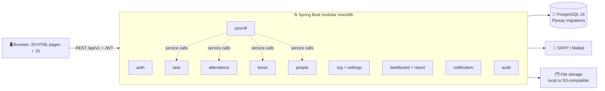

<div align="center">

# 💼 Puk's — Cloud Payroll & Workforce Management System

**A full-stack payroll, attendance, leave and task platform with a task-linked salary engine, built as a secure, modular Spring Boot monolith.**

[](https://github.com/Souvikkundu0901/Puks---Payroll-Management-System/actions/workflows/ci.yml)
[](https://openjdk.org/)
[](https://spring.io/projects/spring-boot)
[](https://www.postgresql.org/)
[](https://flywaydb.org/)
[](docker-compose.yml)
[](LICENSE)

[✨ Features](#features) · [📸 Screenshots](#screenshots) · [🏗️ Architecture](#architecture) · [🚀 Quick start](#quick-start) · [🔐 Security](#security) · [🧪 Testing](#testing)

</div>

---

> 🎓 **About this project.** Puk's is a portfolio and learning project. It models how a real payroll system works (roles, approvals, ledgers, audit trails), but its statutory deductions are simple flat demo amounts and it has not been reviewed for legal or tax compliance. Please do not use it to run real payroll.

## 📖 Table of contents

- [✨ Features](#features)
- [📸 Screenshots](#screenshots)
- [👥 Roles and permissions](#roles)
- [💰 How payroll is calculated](#payroll)
- [🏗️ Architecture](#architecture)
- [🛠️ Tech stack](#tech-stack)
- [🔐 Security](#security)
- [🚀 Quick start](#quick-start)
- [🔑 Demo accounts](#demo-accounts)
- [🔌 API overview](#api)
- [🧪 Testing](#testing)
- [🧯 Troubleshooting](#troubleshooting)
- [📁 Project structure](#structure)
- [🗺️ Known limitations and roadmap](#roadmap)
- [🙏 Acknowledgements](#acknowledgements)
- [👤 Author](#author)

---

<a id="features"></a>
## ✨ Features

| | Area | What it does |
|---|---|---|
| 💵 | **Payroll engine** | A pure-Java calculator with no Spring or JPA imports (enforced by ArchUnit), checked against golden test cases G1 to G8. Handles task-linked retention, unpaid leave, absent days, mid-month joiner proration, flat statutory deductions (PF, TDS, PT) and a net-pay floor. |
| 🪙 | **Two-part disbursement** | 50% of gross is the default part, paid by an Admin action. The remainder is released after manager approval. Retentions of 0, 2 or 7 days are held, released or forfeited with an audit note. |
| 📍 | **Geofenced attendance** | Server-side Haversine checks against office radii or office IP ranges, 15 or 30 minute punctuality grace, half-day logic, midnight-crossing shifts and an automatic end-of-day close job with missed-checkout catch-up. |
| 🌴 | **Leave ledger** | An append-only double-entry ledger with idempotent monthly credits, an annual reset with optional carry-forward, overlap and balance checks, and medical-certificate uploads with content validation. |
| ✅ | **Task management** | Assign, track progress in 10% steps, auto-submit at 100%, then approve, reject or cancel. Only the task's own manager can approve. Every transition is logged on a timeline. |
| 📊 | **Dashboards and calendar** | Separate Admin, Manager and Employee dashboards, plus a calendar of holidays, approved leave and task deadlines. |
| 📑 | **Reports and exports** | Streaming CSV and Excel exports (Apache POI SXSSF) with formula-injection protection, plus PDF payslips and employee ID cards. |
| 🔔 | **Notifications and email** | In-app notification bell, deadline reminders, and login-credential emails for new users (Mailpit locally, any SMTP provider in real use). |
| 🧾 | **Audit trail** | Every change is recorded in an append-only audit log, protected by a database trigger. Admins can filter it and inspect before/after values. |
| 🎨 | **Polished UI** | A responsive 20-page frontend with 9 selectable themes: Light, Dark, Glassmorphism, Bold Typography, Cyberpunk, Neo-Brutalism, Minimalist, Pastel and Sunset. |

**By the numbers:** 130+ REST endpoints · 230+ automated tests · 20 frontend pages · 3 role portals · 9 themes.

---

<a id="screenshots"></a>
## 📸 Screenshots

| 🔐 Login portal | 🧑‍💼 Employee dashboard |
| :---: | :---: |
|  |  |

| 📍 Geofenced attendance | 💵 Salary and payslip | 👔 Manager portal |
| :---: | :---: | :---: |
|  |  |  |

### 🎬 Interactive walkthrough

Download [`assets/walkthrough_video.html`](assets/walkthrough_video.html) and open it in your browser for a six-scene tour across the three roles:

1. 🔑 Dual-token authentication and role-based entry
2. 📈 Employee hub and live KPIs
3. 📍 Geofenced GPS check-in with Haversine verification
4. 🌴 Double-entry leave ledger and manager approvals
5. 💵 Pure-domain payroll engine, retentions and PDF payslips
6. 🧾 Immutable audit trail and streaming Excel/CSV exports

---

<a id="roles"></a>
## 👥 Roles and permissions

| Capability | 👑 Admin | 👔 Manager | 🧑‍💼 Employee |
|---|:---:|:---:|:---:|
| Create and manage employees and managers | ✅ | ❌ | ❌ |
| Assign tasks | ✅ | ✅ (own team) | ❌ |
| Approve or reject tasks | ❌ | ✅ (own tasks only) | ❌ |
| Approve attendance and leave | ✅ | ✅ (own team) | ❌ |
| Generate payroll and release payments | ✅ | ❌ | ❌ |
| Approve payroll records | ✅ (managers' records) | ✅ (own team) | ❌ |
| View salary details | All | Team summary only | Own, with payslip |
| Settings, audit log, reports | ✅ | ❌ | ❌ |

> 🔒 The role always comes from the database account. The role dropdown on the login page is only a visual hint and is never trusted.

---

<a id="payroll"></a>
## 💰 How payroll is calculated

For each employee and month:

1. **Completion %** = approved tasks ÷ tasks due in the month (cancelled tasks excluded). It is never rounded before it is compared with a threshold.
2. **Retention days** depend on completion:

   | Completion | Retention |
   |---|---|
   | 70% or more | 0 days |
   | 50% to 69.99% | 2 days (released automatically in the next month's run) |
   | Below 50% | 7 days (held until an Admin or the manager releases or forfeits it with a note) |

3. **Retention amount** = `gross × retention days ÷ day-rate divisor` (default 30), rounded once to 2 decimals (HALF_UP).
4. **Net pay** = gross − unpaid-leave and absent deductions − retention − statutory deductions, never below zero.
5. **Payout** has two steps: the default 50% part first, then the remainder once the record is approved.

<details>
<summary>🧮 <b>Worked example</b> (one of the golden test cases)</summary>

| Input | Value |
|---|---|
| Gross salary | ₹50,000 |
| Task completion | 55%, so 2 retention days |
| Statutory deductions | ₹3,300 (TDS 1,000 + PF 2,100 + PT 200) |

- Retention = 50,000 × 2 ÷ 30 = **₹3,333.33**
- Net pay = 50,000 − 3,333.33 − 3,300 = **₹43,366.67**
- First payout (default part) = ₹25,000.00, remainder = ₹18,366.67

</details>

---

<a id="architecture"></a>
## 🏗️ Architecture

A **modular monolith**: one deployable with strict module boundaries (`controller → service → repository`). Modules call each other through service interfaces, never through each other's repositories. The Spring Boot app also serves the static frontend, so everything runs on one origin with no CORS.



<details>
<summary>📦 <b>Package layout</b> (<code>com.octopyder.payroll</code>)</summary>

```text
com.octopyder.payroll
├── auth            # JWT issuance, refresh cookie rotation, rate limiting, lockout
├── people          # Employee/manager profiles, AES-256 encrypted bank accounts, ID cards
├── org             # Office locations, geofencing, holidays, system settings registry
├── task            # Task lifecycle, activities, progress, attachments
├── attendance      # Geofenced check-in/out, approvals, daily close job
├── leave           # Double-entry ledger, monthly credit jobs, approvals
├── payroll         # Pure PayrollCalculator, workflow runs, retentions, payslip PDFs
├── dashboard       # Role-specific KPI aggregations (Admin, Manager, Employee)
├── notification    # In-app notifications and email delivery
├── audit           # Append-only audit logs with database immutability triggers
├── report          # Streaming Excel, CSV and PDF report engine
└── common          # BusinessClock, ProblemDetail exception handler, PageResponse
```

</details>

**Key design decisions**
- 🧩 The payroll calculator is a pure class: plain numbers in, plain numbers out. An ArchUnit test fails the build if it imports Spring or JPA.
- 🧾 Money is `NUMERIC(12,2)` and `BigDecimal` with explicit rounding. No floating point anywhere.
- 🕒 All "now" and "today" values come from one injectable clock, so tests are deterministic.
- 🔄 Scheduled jobs are idempotent and catch up on startup, so a restart never loses or doubles work.
- 🧱 The schema is managed only through Flyway migrations (`ddl-auto=validate`).

---

<a id="tech-stack"></a>
## 🛠️ Tech stack

| Layer | Technology |
|---|---|
| Language and framework | Java 25, Spring Boot 4, Spring Security, Spring Data JPA |
| Database | PostgreSQL 16, Flyway |
| Authentication | JWT access tokens, rotated HttpOnly refresh cookie, BCrypt (strength 12) |
| Documents and exports | OpenPDF (payslips, ID cards), Apache POI SXSSF (Excel), Commons CSV |
| Rate limiting | Bucket4j |
| Testing | JUnit 5, Mockito, Testcontainers, ArchUnit, MockMvc |
| Tooling | Maven wrapper, Docker, Docker Compose, Mailpit, GitHub Actions, gitleaks |
| Frontend | HTML5, CSS3, Bootstrap 5, vanilla JavaScript |

---

<a id="security"></a>
## 🔐 Security

| Area | What is in place |
|---|---|
| 🔑 **Authentication** | Short-lived JWT access tokens, rotated HttpOnly refresh cookies stored as hashes (with a 20-second grace window for parallel tabs), token-version revocation, account lockout after 5 failed logins, and a generic login error message. |
| 🛡️ **Authorization** | Role rules on every endpoint plus a service-level team and ownership check, so one user cannot read another's data by guessing an ID. |
| 🔒 **Data protection** | Bank account numbers are encrypted with AES-256-GCM and returned masked (`XXXX-XXXX-1234`). Temporary passwords are random, shown once, never logged or audited, and must be changed at first login. |
| 🧾 **Audit** | Append-only audit log enforced by a database trigger that rejects `UPDATE` and `DELETE`. |
| 🚦 **Abuse protection** | Bucket4j rate limits on authentication, exports and email sending. |
| 📤 **Uploads** | Size limit, extension allowlist and magic-byte checks. Downloads are authorized. |
| 🧱 **Browser hardening** | HSTS, frame denial (`frame-ancestors 'none'`), `nosniff`, Content-Security-Policy, closed CORS, and SHA-384 SRI hashes on CDN assets. |
| 📊 **Export safety** | Cells starting with `=`, `+`, `-` or `@` are escaped to prevent CSV and Excel formula injection. |
| 🔍 **Supply chain** | CI runs a gitleaks secret scan and a check that no page downloads files through unauthenticated `/api/` links. A separate workflow runs a dependency-vulnerability check. |

📄 To report a vulnerability, see the [Security Policy](SECURITY.md).

---

<a id="quick-start"></a>
## 🚀 Quick start

### 📋 Prerequisites

- ☕ **Java 25** (JDK) on your `PATH`
- 🐳 **Docker Desktop**, running
- 📦 Maven is optional: the included wrapper (`./mvnw`) downloads it

### ▶️ Run it

```bash
# 1. Clone
git clone https://github.com/Souvikkundu0901/Puks---Payroll-Management-System.git
cd Puks---Payroll-Management-System

# 2. Start PostgreSQL and Mailpit
docker compose up -d db mailpit

# 3. Run the app with demo seed data
./mvnw spring-boot:run "-Dspring-boot.run.profiles=local" "-Dspring-boot.run.arguments=--app.seed-demo-data=true"
```

On Windows PowerShell, use `.\mvnw` instead of `./mvnw`; the rest is identical.

| Service | URL |
|---|---|
| 🌐 Web application | http://localhost:8080/index.html |
| ❤️ Health check | http://localhost:8080/actuator/health |
| 📬 Mailpit inbox (test emails) | http://localhost:8025 |

> ⚠️ Run the app **one way at a time**: either through Maven (above) or as a Docker container (`docker compose up -d --build`). Doing both makes them fight over port 8080.

### ⚙️ Configuration

All settings come from environment variables. [`.env.example`](.env.example) lists every one (database, JWT and encryption keys, storage, mail, trusted-proxy flag). **Never commit a real `.env` file or real secrets.**

<a id="real-emails"></a>
### 📧 Sending real emails

Mailpit is a fake inbox: it catches every email locally and delivers nothing. To send to real inboxes, set `MAIL_ENABLED=true` and the `MAIL_HOST`, `MAIL_PORT`, `MAIL_USERNAME`, `MAIL_PASSWORD` and `MAIL_FROM` values for your SMTP provider (for Gmail, use an app password).

---

<a id="demo-accounts"></a>
## 🔑 Demo accounts

Created by the demo seed data. **For local demos only. Never reuse these passwords anywhere real.**

| Role | Email | Password | Notes |
|---|---|---|---|
| 👑 **Admin** | `admin@octopyder.com` | `AdminBootstrap123!` | System configuration, payroll runs, reports, audit log |
| 👔 **Manager** | `manager@octopyder.com` | `Manager123!` | Team attendance and leave approvals, task assignment |
| 🧑‍💼 **Employee** (0-day retention) | `ananya.sharma@octopyder.com` | `Employee123!` | Senior Backend Engineer, full payout |
| 🧑‍💼 **Employee** (2-day retention) | `priya.patel@octopyder.com` | `Employee123!` | Frontend Engineer, 2-day auto-released retention |
| 🧑‍💼 **Employee** (7-day retention) | `suresh.raina@octopyder.com` | `Employee123!` | Junior Developer, 7-day held retention |

**🧭 Try this flow:** log in as **Admin** → add an employee and copy the one-time temporary password (or read the email in Mailpit) → log in as that employee and set a new password → mark attendance and apply for leave → log in as the **Manager** to approve → back as **Admin**, generate payroll and open the payslip.

---

<a id="api"></a>
## 🔌 API overview

Base path `/api/v1`. JSON in and out. Errors use RFC 9457 `ProblemDetail` with a stable `code` field.

| Group | Examples |
|---|---|
| 🔐 **Auth** | `POST /auth/login`, `/auth/refresh`, `/auth/logout`, `GET /auth/me`, `POST /auth/change-password` |
| 👥 **People** | `/employees`, `/managers`, `/departments`, `/me/profile`, `/me/documents` |
| ✅ **Tasks** | `/tasks`, `/tasks/{id}/start`, `/progress`, `/approve`, `/reject` |
| 📍 **Attendance** | `/attendance/check-in`, `/check-out`, `/attendance/pending`, `/bulk-decision` |
| 🌴 **Leave** | `/leave/requests`, `/leave/me/balance`, `/approve`, `/reject` |
| 💵 **Payroll** | `/payroll/preview`, `/payroll/runs`, `/records/{id}/approve`, `/release-default`, `/release`, `/payslip.pdf` |
| 📊 **Insight** | `/dashboard/{admin,manager,employee}`, `/calendar/events`, `/notifications`, `/reports/*`, `/audit-logs` |
| ⚙️ **Admin** | `/settings/{group}`, `/settings/office-locations`, `/holidays` |

---

<a id="testing"></a>
## 🧪 Testing

```bash
./mvnw clean verify     # unit + integration tests (Testcontainers starts its own PostgreSQL)
./smoke-test.sh         # end-to-end check against the running app (Git Bash on Windows)
```

The suite covers:

- 💵 payroll golden cases and rounding boundaries
- 🧩 architecture rules, such as keeping the calculator free of Spring and JPA
- 🔐 authorization tests for every role, including cross-user access
- 🧵 concurrency cases such as double approval and duplicate check-in
- 🗄️ repository and migration tests against a real PostgreSQL

✅ GitHub Actions runs `./mvnw verify` on every push and pull request.

---

<a id="troubleshooting"></a>
## 🧯 Troubleshooting

| Problem | Fix |
|---|---|
| `Port 8080 was already in use` | Another copy is running. Find it with `netstat -ano \| findstr :8080`, then stop it (`taskkill /PID <id> /F` on Windows), or run `docker compose down`. |
| `Connection refused` to the database | Run `docker compose up -d db mailpit` and wait until `docker ps` shows the database as healthy. |
| `no configuration file provided` | Run the command from the project folder (the one containing `docker-compose.yml`). |
| Data disappeared | `docker compose down -v` deletes the database volume. Use plain `docker compose down`. |
| Emails do not reach Gmail | Mailpit is a fake inbox. See [Sending real emails](#real-emails). |

---

<a id="structure"></a>
## 📁 Project structure

```text
.
├── src/main/java/com/octopyder/payroll/   # backend modules (see Architecture)
├── src/main/resources/                    # configuration, Flyway migrations
├── src/test/                              # unit, integration and architecture tests
├── frontend/                              # the 20 HTML pages, CSS and JS
├── assets/                                # screenshots and walkthrough
├── .github/workflows/                     # CI and dependency check
├── docker-compose.yml                     # PostgreSQL, Mailpit and the app
├── Dockerfile
├── smoke-test.sh
├── SECURITY.md
├── LICENSE
└── .env.example
```

---

<a id="roadmap"></a>
## 🗺️ Known limitations and roadmap

This is a learning project, and these are its honest gaps:

- 🚫 It is not deployed anywhere. It runs locally with Docker.
- 🔁 There is no "forgot password" page yet. An Admin resets passwords instead.
- 🔢 There is no two-factor authentication.
- 💸 Statutory deductions are flat demo amounts, not tax-slab calculations.
- 🖥️ It runs as a single instance: rate limits and caches are held in memory.
- 🧱 The frontend uses inline event handlers, so the Content-Security-Policy still allows inline scripts. Moving them into script files would allow a stricter policy.

**💡 Ideas for next steps:** a forgot-password flow, TOTP two-factor login, slab-based tax rules, an invite-link onboarding email instead of an emailed temporary password, and a cloud deployment with scheduled encrypted backups.

---

<a id="acknowledgements"></a>
## 🙏 Acknowledgements

- 🎨 **Frontend (UI and design):** created by [@Naitik-26](https://github.com/Naitik-26): the 20 responsive pages, layouts and 9 themes across the Admin, Manager and Employee portals. The backend, database, security, tests and the integration of the two are my own work.
- 🧰 Built with Spring Boot, PostgreSQL, Flyway, Testcontainers, OpenPDF, Apache POI, Bucket4j and Mailpit.

---

<a id="author"></a>
## 👤 Author

**Souvik Kundu** · final-year BCA student, aspiring Java / backend developer

[](https://www.linkedin.com/in/souvikkundu19)
[](https://github.com/Souvikkundu0901)

⭐ If you like this project, consider giving it a star.

📄 Released under the terms of the [license](LICENSE).
